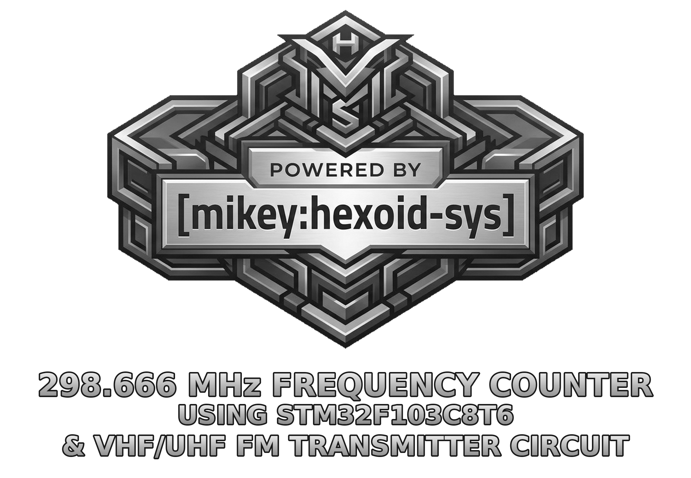
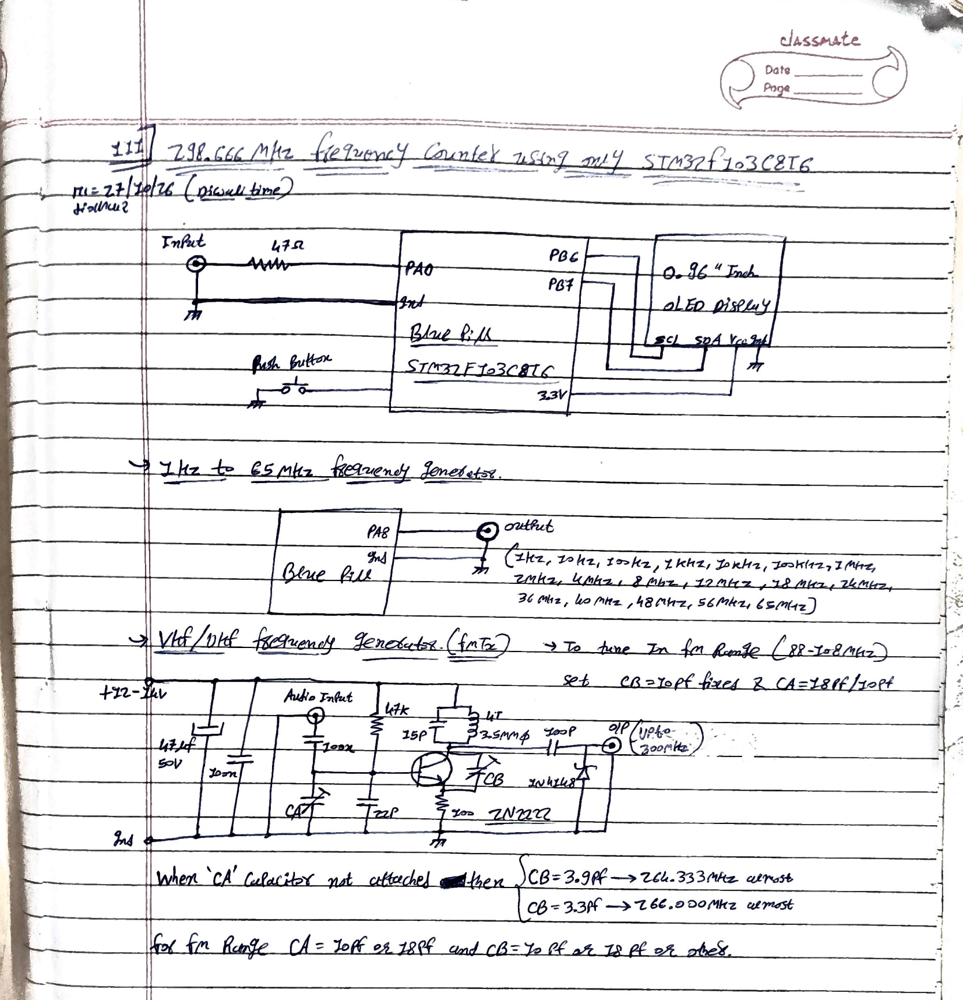
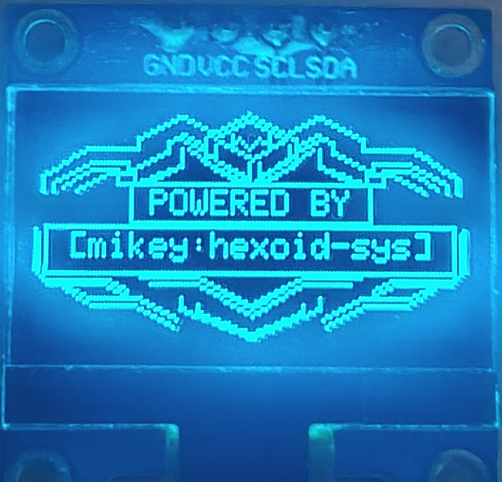
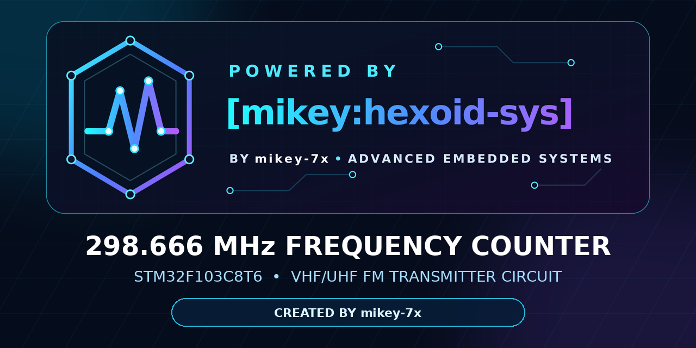

# 298.666mhz frequency counter using stm32f103c8t6 & vhf/uhf fm transmitter circuit

<p align="center">
  
</p>

<p align="center">
  <strong>Created by <a href="https://github.com/mikey-7x">mikey-7x</a> — Yogesh R. Chauhan</strong>
</p>

<p align="center">
  <a href="https://github.com/mikey-7x/298.666mhz-frequency-counter-using-stm32f103c8t6-and-vhf-uhf-fm-transmitter-circuit"></a>
  <a href="https://github.com/mikey-7x"></a>
  <a href="LICENSE"></a>
</p>

> A highly optimised STM32F103C8T6 frequency-measurement system containing a 298.666 MHz-class OLED counter, an exact automatic frequency generator for bench regression tests, and the author's VHF/UHF FM-transmitter circuit notes for lawful, controlled laboratory testing.

> **Compilation tool by mikey-7x:** [mikey:hexoid v5.0.0 — open the GitHub repository](https://github.com/mikey-7x/mikey-hexoid-v5.0.0/tree/main)  
> The author uses this tool to compile this project's STM32 firmware. It also supports selected AVR and FPGA workflows; available output formats depend on the target and toolchain. See the [build and flashing guide](docs/mikey-hexoid-and-zflasher.md).

## Official links

| Destination | Link |
|---|---|
| Official project repository | [https://github.com/mikey-7x/298.666mhz-frequency-counter-using-stm32f103c8t6-and-vhf-uhf-fm-transmitter-circuit](https://github.com/mikey-7x/298.666mhz-frequency-counter-using-stm32f103c8t6-and-vhf-uhf-fm-transmitter-circuit) |
| Author GitHub profile | [https://github.com/mikey-7x](https://github.com/mikey-7x) |
| Author repository catalogue | [https://github.com/mikey-7x?tab=repositories](https://github.com/mikey-7x?tab=repositories) |
| Compilation tool: mikey:hexoid v5.0.0 | [https://github.com/mikey-7x/mikey-hexoid-v5.0.0/tree/main](https://github.com/mikey-7x/mikey-hexoid-v5.0.0/tree/main) |
| Author YouTube channel | [https://youtube.com/@mikey-7x](https://youtube.com/@mikey-7x) |
| FM-radio verification video | [Watch the demonstration](https://youtu.be/2F3CqLfh4eI) |
| Author blog | [https://rtod-yv8.blogspot.com/?m=1](https://rtod-yv8.blogspot.com/?m=1) |

## Project highlights

- **298.666... MHz display ceiling** at the default verified 112 MHz TIM2CLK.
- **224 MHz normal-design ceiling**; readings above it are honestly marked `MHz EXP`.
- Hardware **TIM3:TIM2 32-bit counter** using TIM2 TRGO and TIM3 ITR1.
- Asynchronous **ETR/8** high-frequency input path with stability-qualified gates.
- Independent **TI1F cross-check at and below 40 MHz** on the same PA0 input.
- Fast **100 ms high-range tracking gates** followed by 250 ms precision gates.
- No phantom readings: a disconnected input reports **NO SIGNAL**.
- 0.96-inch SSD1306 OLED, automatic Hz/kHz/MHz formatting and raw count `N` shown with every qualified reading.
- Complete-frame OLED recovery and redraw after an I2C disturbance.
- **No external Arduino libraries** are required by either firmware sketch.
- Companion generator with an exact normal sweep from **1 Hz to 36 MHz** and optional experimental exact steps at **40, 48, 56 and 64 MHz**.
- Author's complete hand-drawn system circuit is included in this repository.

> **Important range statement:** 298.666... MHz is the synchronizer-derived display ceiling at 112 MHz TIM2CLK, not a promise that every cloned Blue Pill and every waveform will count accurately at the boundary. Above 224 MHz the firmware adds `EXP` because operation is between ST's conservative /4 design rule and the /3 resynchronizer boundary. Perform your own verification with a known source.

---

## Contents

- [Complete circuit diagram](#complete-circuit-diagram)
- [System architecture](#system-architecture)
- [Counter range and theory](#counter-range-and-theory)
- [OLED startup photo](#oled-startup-photo)
- [Demonstration video](#demonstration-video)
- [Author's recorded bench evidence](#authors-recorded-bench-evidence)
- [Wiring](#wiring)
- [Frequency-counter firmware](#frequency-counter-firmware)
- [Frequency-generator firmware](#frequency-generator-firmware)
- [VHF/UHF FM transmitter notes](#vhfuhf-fm-transmitter-notes)
- [Precompiled counter and Android flashing](#precompiled-counter-and-android-flashing)
- [Building and flashing](#building-and-flashing)
- [Operating the counter](#operating-the-counter)
- [Recommended verification sequence](#recommended-verification-sequence)
- [Repository layout](#repository-layout)
- [Official brand assets](#official-brand-assets)
- [Licence, credit and commercial use](#licence-credit-and-commercial-use)
- [About the author](#about-the-author)
- [Safety and legal notice](#safety-and-legal-notice)

---

## Complete circuit diagram

The following is the author's original complete system sheet, preserved without redrawing the circuit:



A contrast-enhanced copy with the same geometry is also supplied as [`hardware/complete-circuit-diagram-enhanced.png`](hardware/complete-circuit-diagram-enhanced.png).

The sheet contains three sections:

1. STM32F103C8T6 frequency counter, PA0 input, 47 Ω input resistor and 0.96-inch I2C OLED on PB6/PB7.
2. Second STM32F103C8T6 automatic frequency generator using PA8 as output.
3. VHF/UHF FM-transmitter oscillator built around a 2N2222 transistor and a hand-wound tank coil.

---

## System architecture

```text
                         POWERED BY [mikey:hexoid-sys]
                         Created by mikey-7x — Yogesh R. Chauhan

  STM32 generator                         STM32 counter
 ┌──────────────────┐                     ┌──────────────────────────────┐
 │ TIM1 output PA8  │── 47 Ω ───────────▶│ PA0 / TIM2 ETR + TI1F       │
 │ exact step table │                     │ TIM3:TIM2 32-bit hardware   │
 │ optional PB12    │                     │ stability-qualified gates   │
 └────────┬─────────┘                     │ range + fault state machine │
          │ GND                            └──────────────┬───────────────┘
          └───────────────────────────────────────────────┤ GND
                                                           │
                                                  SSD1306 OLED
                                                  PB6=SCL, PB7=SDA

  FM-transmitter test oscillator ── controlled bench signal ──▶ counter PA0
```

No external prescaler IC, frequency-divider IC or Arduino library is used by the counter. The high reach comes from using the timer peripherals in a carefully bounded way:

1. TIM2's asynchronous ETR prescaler divides the PA0 edge stream by eight.
2. The resulting ETRP stream crosses the timer's internal resynchronizer.
3. TIM2 counts the synchronized stream.
4. Every TIM2 update event is routed from TRGO to TIM3's ITR1 input.
5. TIM3 therefore forms the upper 16 bits of a hardware 32-bit count.
6. Firmware takes coherent TIM3:TIM2 snapshots; CPU scheduling cannot lose an overflow.
7. Multiple time slices inside each gate must agree before a number is displayed.

---

## Counter range and theory

TIM2CLK is calculated from the clock that actually starts successfully—not merely from the value requested at compile time. Two ceilings are then derived:

| Ceiling | Formula through ETR/8 | Meaning |
|---|---|---|
| Normal design ceiling | `2 × TIM2CLK` | ETRP at or below TIM2CLK/4 |
| Experimental display ceiling | `8 × TIM2CLK / 3` | ETRP at or below TIM2CLK/3 |

| Verified TIM2CLK | Displayed normally | Displayed as `MHz EXP` up to | Splash maximum |
|---:|---:|---:|---:|
| 72 MHz | 144 MHz | 192 MHz | `MAX 192MHZ EXP` |
| 96 MHz | 192 MHz | 256 MHz | `MAX 256MHZ EXP` |
| **112 MHz default** | **224 MHz** | **298.666... MHz** | **`MAX 298MHZ EXP`** |

At 112 MHz TIM2CLK:

| Counted input | ETRP after /8 | TIM2CLK / ETRP |
|---:|---:|---:|
| 182.8712 MHz | 22.8589 MHz | 4.900 |
| 192 MHz | 24.0000 MHz | 4.667 |
| 224 MHz | 28.0000 MHz | 4.000 |
| 274.4738 MHz | 34.3092 MHz | 3.264 |
| 298.6667 MHz | 37.3333 MHz | 3.000 |

Above the display ceiling, the counter does not invent a scaled answer. It shows `OVER RANGE`, the dynamic synchronizer limit and the raw qualified count `N`, so the gate can still be audited manually.

### Why there is no software-only 1 GHz claim

A 1 GHz input remains 125 MHz after ETR/8. That would require a timer clock of at least 375 MHz by the /3 resynchronizer relationship or 500 MHz by the /4 design rule. A stock STM32F103 cannot provide that clock, and TIM2's synchronous prescaler is after the resynchronizer, so it cannot recover pulses already dropped. Accurate GHz counting would require a different external high-speed front end.

---

## OLED startup photo

<p align="center">
  
</p>

The author's photo shows the updated pixel-art logo on the actual 0.96-inch SSD1306 display. The author also reported that the subsequent `SELF PASS` screen appeared correctly; that screen is not shown in this photograph. The logo uses the display's single-colour pixels, not the silver shading of the original artwork. [View the full photograph](docs/oled-startup-photo.jpg) or compare it with the [pixel-accurate simulation](docs/oled-startup-preview.png).

A successful startup/self-test confirms the observed startup sequence, not frequency accuracy or the counter's maximum operating range. Test measurements separately with a suitable reference.

---

## Demonstration video

[](https://youtu.be/2F3CqLfh4eI)

[Watch the separate FM-radio demonstration on YouTube](https://youtu.be/2F3CqLfh4eI): the author shows the counter reading an FM transmitter and then checks reception at the displayed frequency using a keypad phone's FM radio. Radio tuning resolution and accuracy limit this comparison; it is not proof of performance at 192 MHz or the calculated 298.666 MHz ceiling. Use RF equipment lawfully and in a controlled setup.

---

## Author's recorded bench evidence

The following values are retained in the project documentation because they allow the raw arithmetic to be checked independently:

| Evidence | Raw count and gate | Result |
|---|---:|---:|
| Stable transmitter reading | `N=21,613,040`, 1 s | 172.904320 MHz |
| Stable transmitter reading | `N=22,165,372`, 1 s | 177.322976 MHz |
| Stable transmitter reading | `N=22,853,784`, 1 s | 182.830272 MHz |
| Stable transmitter reading | `N=22,858,903`, 1 s | 182.871224 MHz |
| High counted-edge rate | `N=8,572,621`, 250 ms | 274.323872 MHz |
| High counted-edge rate | `N=34,309,220`, 1 s | 274.473760 MHz |

The two high-rate gates agree within approximately 0.055%. They establish a repeatable counted-edge rate on the author's board. As with any oscillator measurement, ringing, harmonics, parasitic oscillation or extra threshold crossings must be ruled out before treating a counted-edge rate as proof of an emitted fundamental.

The author's circuit sheet also records these approximate transmitter bench results when `CA` is not attached:

- `CB = 3.9 pF` → approximately **264.333 MHz**
- `CB = 3.3 pF` → approximately **266.000 MHz**

Expected raw counts for frequently used check points are:

| Frequency | 1 s count | 250 ms count | 100 ms count |
|---:|---:|---:|---:|
| 192 MHz | 24,000,000 | 6,000,000 | 2,400,000 |
| 224 MHz | 28,000,000 | 7,000,000 | 2,800,000 |
| 274.473760 MHz | 34,309,220 | about 8,577,305 | about 3,430,922 |
| 298.666667 MHz | 37,333,333 | about 9,333,333 | about 3,733,333 |

---

## Wiring

### Frequency counter

| Counter item | Connection |
|---|---|
| Signal input connector centre | 47 Ω resistor → PA0 |
| Signal input connector ground | Blue Pill GND |
| OLED SCL | PB6 |
| OLED SDA | PB7 |
| OLED VCC | 3.3 V |
| OLED GND | GND |
| Alternate OLED port supported by firmware | PB8=SCL, PB9=SDA |
| OLED I2C address | 0x3C or 0x3D, automatically probed |

PA0 is configured with its internal pull-down by the measurement setup. The input must remain a logic-level waveform within the STM32F103C8T6 electrical limits. The 47 Ω resistor shown by the author is part of the tested interconnection; it is not a substitute for proper level conditioning of an arbitrary RF source.

### Frequency generator

| Generator item | Connection |
|---|---|
| TIM1 output | PA8 |
| Output to counter | PA8 → 47 Ω → counter PA0 |
| Ground | Common GND between both boards |
| Optional push button | PB12 → normally-open switch → GND |
| Status LED | PC13 onboard LED, active low |

### Transmitter test source

Use only a controlled, lawful bench arrangement. Keep leads short and grounds controlled at VHF/UHF, mechanically stabilise the tank components, and verify the voltage at PA0 before connecting an experimental oscillator. The author's original drawing in `hardware/` is the construction reference supplied with this repository.

---

## Frequency-counter firmware

Source: [`firmware/frequency_counter/frequency_counter.ino`](firmware/frequency_counter/frequency_counter.ino)

### Identity shown by the firmware

At startup, the OLED first shows a custom 128×64 monochrome pixel-art adaptation of the supplied logo for 3 seconds once the screen is ready. It uses clean isometric outlines and readable pixel lettering. The one-bit screen cannot reproduce the original silver shading or all fine details. If the OLED initializes late, the startup screens are retried when it recovers. [View the enlarged pixel-accurate OLED preview](docs/oled-startup-preview.png). The following existing self-test screen displays the exact branding in text:

```text
POWERED BY
[mikey:hexoid-sys]
SELF PASS / SELF FAIL
SYSCLK and actual range information
BY mikey-7x
```

During measurement, the header reads `mikey-7x COUNTER`. The source header and embedded firmware identity string also contain the author, project title, powered-by line and licence name. These notices are part of the licence conditions and must not be removed.

### Main compile-time settings

| Setting | Default | Purpose |
|---|---:|---|
| `COUNTER_CLOCK_MHZ` | `112` | 112 MHz proven high-VHF configuration; 96 MHz comparison; 72 MHz normal clock |
| `CAL_PPM` | `0.0` | Optional reference-clock correction only; never use it to disguise dropped counts |
| `LOGO_SPLASH_MS` | `3000` | Startup image duration in milliseconds; set `0` to skip it |
| `GATE_MS` | `1000` | Primary precision gate |
| `HIGH_TRACK_GATE_MS` | `100` | Fast high-range reacquisition gate |
| `HIGH_GATE_MS` | `250` | High-range precision retry gate |

The 112 MHz and 96 MHz settings exceed the STM32F103's specified 72 MHz system-clock maximum. The splash therefore reports the clock that was actually verified. If an experimental selection fails, firmware falls back through its clock-selection path and the displayed maximum changes accordingly.

### Measurement states

| OLED state | Meaning |
|---|---|
| `NO SIGNAL` | No valid edge rate was measured; no number is invented |
| `INPUT CHANGING` | A gate contained real edges but did not remain stable enough to qualify |
| `HIGH SIGNAL LOST` | A recently proven high input is being reacquired on ETR/8 |
| `COUNT SYNC LOST` | A coherent TIM3:TIM2 snapshot could not be obtained |
| `TIMER CONFIG FAILED` | A required timer register read-back did not match the requested configuration |
| `OVER RANGE` | A qualified count exceeded the derived synchronizer display ceiling |
| `MHz EXP` | A qualified count is above the /4 design ceiling but not above the /3 boundary |

---

## Frequency-generator firmware

Source: [`firmware/frequency_generator/frequency_generator.ino`](firmware/frequency_generator/frequency_generator.ino)

The generator provides an automatic bench sequence with exact nominal timer divisors. Each supported step dwells for 15 seconds. Actual output accuracy depends on the clock reference and board stability; use an independent instrument when accuracy matters.

### Default normal-clock sequence

```text
1 Hz, 10 Hz, 100 Hz,
1 kHz, 10 kHz, 100 kHz,
1 MHz, 2 MHz, 4 MHz, 8 MHz, 12 MHz, 18 MHz, 24 MHz, 36 MHz
```

### Requested diagnostic list (`SWEEP_MODE 1`)

Setting `SWEEP_MODE` to `1` selects the original requested list, but does **not** make every requested frequency physically attainable. With the 72 MHz timer clock, the entries from 1 Hz through 1 MHz in that list have supported nominal divisors. The requested 10, 20, 27, 33, 50, 68, 72 and 80 MHz entries are unsupported in this mode: PA8 is forced LOW and the LED repeats four flashes instead of substituting an inaccurate output. This mode cannot be combined with `TOP_EXPERIMENT_64MHZ` or fixed-frequency diagnostics.

### Optional experimental top sequence

Set:

```cpp
#define TOP_EXPERIMENT_64MHZ 1
```

This appends:

```text
40 MHz, 48 MHz, 56 MHz, 64 MHz
```

The authored code's exact top TIM1 step is **64 MHz**, not 65 MHz. The hand-drawn sheet uses an approximate “65 MHz” label; this README and the firmware table preserve the precise value. The 64 MHz step is staged at 112 MHz and executed through an SRAM-isolated 128 MHz dwell, after which the firmware restores the normal 72 MHz core before returning to flash execution.

### Button and LED behaviour

- Short press and release PB12: advance to the next step.
- Hold PB12 for at least one second: pause or resume the automatic sweep without stopping the present TIM1 output, except during the SRAM-isolated 64 MHz step described below.
- Single heartbeat: automatic sweep.
- Double heartbeat: paused.
- Three flashes: successful boot configuration.
- Two flashes: supported new step.
- Four repeated flashes: unsupported requested step; PA8 is forced LOW.
- Five repeated flashes: timer-clock/configuration fault.

**64 MHz button limitation:** PB12 is not read during the SRAM-isolated 64 MHz dwell. In automatic sweep the step returns after its timed dwell; button presses during that dwell are ignored. If 64 MHz is entered while the sweep is paused, the hold is indefinite and PB12 cannot resume it: reset or power-cycle the generator to leave that state. The fixed 64 MHz diagnostic also holds until reset or power-off. This is a limitation of the current firmware, not a claim that the button works in this state.

Fixed diagnostic settings are available through `FIXED_TEST_8MHZ`, `FIXED_TEST_36MHZ` and `FIXED_TEST_64MHZ`. Only one may be selected, and PB12 is ignored completely in a fixed test so a diagnostic source cannot drift to another table entry.

---

## VHF/UHF FM transmitter notes

The bottom section of [`hardware/complete-circuit-diagram.png`](hardware/complete-circuit-diagram.png) is the author's FM-transmitter oscillator. Values visible in the drawing include:

| Item | Author's drawing |
|---|---|
| Supply marked on sheet | +12 V to +14 V |
| Reservoir capacitor | 47 µF, 50 V |
| RF decoupling | 100 nF |
| Audio coupling | 100 nF marking in the drawing |
| Base resistor | 47 kΩ |
| Base capacitor | 22 pF |
| Tank capacitor | 15 pF |
| Tank coil | 4 turns, approximately 3.5 mm diameter |
| Transistor | 2N2222 |
| Emitter resistor | 100 Ω |
| Output coupling | 100 pF |
| Output diode | 1N4148 |
| `CA` | variable/selected capacitor in the audio-side network |
| `CB` | variable/selected feedback/tank capacitor as drawn |

For tuning inside the FM broadcast range, the sheet says to set `CB = 10 pF` fixed and use `CA = 18 pF` or `10 pF`. A further note permits `CA = 10 pF` or `18 pF`, with `CB = 10 pF`, `18 pF`, or another experimentally selected value.

When `CA` is not attached, the author's recorded high-range examples are:

- `CB = 3.9 pF` → almost 264.333 MHz
- `CB = 3.3 pF` → almost 266.000 MHz

Transistor pinout varies by package and manufacturer. Verify the exact 2N2222 device datasheet before assembly rather than relying only on the hand-drawn symbol orientation. Small changes in coil geometry, lead length, stray capacitance, supply voltage and mechanical movement can move a free-running VHF/UHF oscillator substantially.

> This repository presents the transmitter as an experimental measurement source for the counter project. It does not authorise radio transmission. Use a dummy load or properly shielded bench setup and comply with all local spectrum rules.

---

## Precompiled counter and Android flashing

The author's four original counter files are available in [the precompiled counter folder](incoming-counter-build/README.md): [HEX](incoming-counter-build/v23gen2.hex), [BIN](incoming-counter-build/v23gen2.bin), [ELF](incoming-counter-build/v23gen2.elf) and [MAP](incoming-counter-build/v23gen2.map). On GitHub, open the HEX and use **Download raw file**. The HEX is for the **counter board only**; do not flash it to the generator.

For a quick upload, connect your known-working ST-LINK/V2 to the counter and Android phone through OTG. In **ZFlasher STM32**, select the counter HEX and the write/program operation, then tap **Go!**. Verify the operation if available. Flashing overwrites program contents; keep any required backup first. The HEX contains addresses. The BIN is a raw image intended for `0x08000000`; the ELF and MAP are for analysis, not this flashing procedure. The counter uses an experimental 112 MHz default clock, above the MCU's 72 MHz rating.

To compile your own counter or generator with [mikey:hexoid v5.0.0](https://github.com/mikey-7x/mikey-hexoid-v5.0.0/tree/main), use **Compile Project (Universal)** and BluePill F103C8 board ID **40**. The tool's default USB option differs from the author's verified image; read the [short build and ZFlasher guide](docs/mikey-hexoid-and-zflasher.md) before building or flashing. No extra Arduino libraries are needed by these sketches.

The published HEX and BIN match an independently reproduced build of the present counter with the documented HID build option. The ELF load bytes match the BIN; the HEX contains the same addressed bytes but omits four padding bytes. The project verifier checks the artifact integrity. These checks and `SELF PASS` do not establish frequency accuracy.

---

## Building and flashing

### Toolchain

- mikey:hexoid v5.0.0 (the author's workflow), Arduino IDE, or Arduino CLI with the STM32duino STM32 core.
- Board family: Generic STM32F1 series.
- Board part: BluePill F103C8.
- USB interface used for the repository build checks: HID.
- Upload using the method appropriate to your board and preferred flashing tool.

Equivalent Arduino CLI target:

```text
STMicroelectronics:stm32:GenF1:pnum=BLUEPILL_F103C8,usb=HID
```

Example builds from the repository root:

```sh
arduino-cli compile \
  --fqbn STMicroelectronics:stm32:GenF1:pnum=BLUEPILL_F103C8,usb=HID \
  firmware/frequency_counter

arduino-cli compile \
  --fqbn STMicroelectronics:stm32:GenF1:pnum=BLUEPILL_F103C8,usb=HID \
  firmware/frequency_generator
```

Each Arduino sketch folder name matches its `.ino` basename:

```text
firmware/frequency_counter/frequency_counter.ino
firmware/frequency_generator/frequency_generator.ino
```

No Library Manager downloads are needed for project libraries. The counter contains its own compact SSD1306 driver and 5×7 font rendering.

---

## Operating the counter

1. Power the counter with PA0 disconnected.
2. Read the complete splash screen. For the intended high-range configuration it should identify a **112 MHz** system clock and **MAX 298MHZ EXP**.
3. Confirm that the normal disconnected state becomes `NO SIGNAL`.
4. Connect a known source and start at a low or moderate frequency.
5. Observe both the formatted reading and the raw `N=` count.
6. Note the gate label:
   - `ETR/8 1s GATE` is the primary precision path.
   - `ETR/8 100ms TRACK` is a qualified fast high-range gate.
   - `ETR/8 250ms GATE` is a qualified high-range precision retry.
   - Labels mentioning TI1F show that the low/mid-frequency cross-check participated.
7. When hand-tuning an LC oscillator, move slowly and dwell. A tracking gate can qualify after 100 ms of adequate stability, but a following 1 s gate remains the preferred confirmation.
8. Treat `MHz EXP` as an experimental-range marker. Confirm important results with an independent receiver, spectrum analyser, calibrated counter or other suitable instrument.

---

## Recommended verification sequence

A disciplined sequence prevents a high-range result from being accepted before the basic paths are known to work:

1. Counter disconnected → `NO SIGNAL`.
2. Generator at 1 Hz, 100 Hz, 1 kHz and 100 kHz.
3. Generator at 1, 8, 12, 24 and 36 MHz.
4. Optional generator top steps at 40, 48, 56 and 64 MHz.
5. A transmitter frequency independently confirmed by a lawful receiver measurement, such as the author's approximately 92 MHz FM-radio check.
6. Repeat a known stable high point around 182.87 MHz if the same oscillator condition can be reproduced.
7. Tune slowly through 192 MHz; record the gate label and `N`.
8. Test 224 MHz, the /4 design boundary.
9. Above 224 MHz, compare repeated 100 ms, 250 ms and 1 s gates and retain the `EXP` qualification.
10. Near 298.666 MHz, expect margin to disappear; a rejected or intermittent gate is more trustworthy than relaxing the stability rules until a desired number appears.

A reusable record sheet is provided in [`docs/test-record.csv`](docs/test-record.csv).

---

## Repository layout

```text
.
├── README.md
├── LICENSE
├── NOTICE.md
├── AUTHORS.md
├── CITATION.cff
├── CODEOWNERS
├── COMMERCIAL-LICENSING.md
├── CONTRIBUTING.md
├── SECURITY.md
├── project-metadata.json
├── .github/
│   ├── workflows/firmware-builds.yml
│   ├── ISSUE_TEMPLATE/
│   └── pull_request_template.md
├── assets/
│   ├── README.md
│   ├── project-title-logo.png
│   ├── github-social-preview.png
│   ├── powered-by-mikey-hexoid-sys.svg
│   ├── powered-by-mikey-hexoid-sys.png
│   ├── mikey-hexoid-sys-mark.svg
│   └── mikey-hexoid-sys-mark.png
├── incoming-counter-build/
│   ├── README.md
│   ├── SHA256SUMS
│   ├── v23gen2.hex
│   ├── v23gen2.bin
│   ├── v23gen2.elf
│   └── v23gen2.map
├── firmware/
│   ├── frequency_counter/
│   │   └── frequency_counter.ino
│   └── frequency_generator/
│       └── frequency_generator.ino
├── hardware/
│   ├── complete-circuit-diagram.png
│   ├── complete-circuit-diagram-enhanced.png
│   └── bill-of-materials.md
├── docs/
│   ├── theory-and-limits.md
│   ├── build-and-operation.md
│   ├── mikey-hexoid-and-zflasher.md
│   ├── transmitter-notes.md
│   ├── validation-checklist.md
│   ├── build-results.txt
│   ├── oled-startup-preview.png
│   ├── oled-startup-photo.jpg
│   └── test-record.csv
└── tools/
    ├── verify_repository.py
    └── verify_precompiled.py
```

---

## Official brand assets

The project-title logo at the top, the main attribution logo in [NOTICE.md](NOTICE.md), the compact author-credit logo at the bottom, and the social-preview layout below all use the same **POWERED BY [mikey:hexoid-sys]** emblem with transparent surroundings:

<p align="center">
  
</p>

| Use | PNG image | SVG container |
|---|---|---|
| Project-title logo in the README header | [Project-title PNG](assets/project-title-logo.png) | — |
| Main attribution logo | [Main PNG](assets/powered-by-mikey-hexoid-sys.png) | [Main SVG](assets/powered-by-mikey-hexoid-sys.svg) |
| Compact author-credit logo | [Square PNG](assets/mikey-hexoid-sys-mark.png) | [Square SVG](assets/mikey-hexoid-sys-mark.svg) |
| GitHub social preview | [Social-preview PNG](assets/github-social-preview.png) | — |

The SVG files embed raster artwork; they are not fully editable vector illustrations. For link previews, upload the social-preview PNG in **Settings → General → Social preview**; adding a file to `assets/` does not change that setting.

---

## Licence, credit and commercial use

Copyright © 2026 **Yogesh R. Chauhan (mikey-7x)**. All rights reserved.

This project is released only under the custom **mikey-7x Strict Personal & Educational Use Licence** in [`LICENSE`](LICENSE). In summary:

- You may study, build and use the project for personal or non-commercial educational purposes only when the licence is followed completely.
- Credit to **mikey-7x**, the exact line **POWERED BY [mikey:hexoid-sys]**, the copyright notice and the supplied logo are mandatory where the licence requires attribution.
- Removing or disguising the credit, logo, source notices or embedded firmware identity is prohibited.
- Selling the software, hardware, circuits, documentation, kits, PCBs, assembled units or derivative resources is prohibited.
- Commercial, manufacturing and industrial use is prohibited without a separate signed written licence from Yogesh R. Chauhan (mikey-7x).
- Business and industrial enquiries: read [`COMMERCIAL-LICENSING.md`](COMMERCIAL-LICENSING.md), then contact the author through the [GitHub profile](https://github.com/mikey-7x) or the [commercial-licence issue form](https://github.com/mikey-7x/298.666mhz-frequency-counter-using-stm32f103c8t6-and-vhf-uhf-fm-transmitter-circuit/issues/new/choose).

The summary above is for convenience only. The complete [`LICENSE`](LICENSE) controls.

---

## About the author

[](https://github.com/mikey-7x)

**Yogesh R. Chauhan (mikey-7x)** — Software Developer | Open-Source Contributor | EC Specialist

> **Identity notice:** “mikey-7x” and “mikey” are the online pseudonyms of **Yogesh R. Chauhan** (also known as Chauhan Yogeshkumar R.). All repositories under the `mikey-7x` account are authored by the same person unless otherwise noted.

Yogesh holds a Diploma in **Electronics and Communication (EC)** from BBIT, India. His engineering work bridges low-level software architecture with the electrical behaviour and timing limits of real hardware. This project is built on his custom **[mikey:hexoid-sys]** architecture and is presented as a **POWERED BY [mikey:hexoid-sys]** project.

The profile description includes open-source work in other repositories; this particular project is intentionally **source-available under a strict personal and educational licence**, not an open-source release.

- GitHub profile: [https://github.com/mikey-7x](https://github.com/mikey-7x)
- Complete repository catalogue: [https://github.com/mikey-7x?tab=repositories](https://github.com/mikey-7x?tab=repositories)
- Official project repository: [https://github.com/mikey-7x/298.666mhz-frequency-counter-using-stm32f103c8t6-and-vhf-uhf-fm-transmitter-circuit](https://github.com/mikey-7x/298.666mhz-frequency-counter-using-stm32f103c8t6-and-vhf-uhf-fm-transmitter-circuit)
- YouTube: [https://youtube.com/@mikey-7x](https://youtube.com/@mikey-7x)
- Blog: [https://rtod-yv8.blogspot.com/?m=1](https://rtod-yv8.blogspot.com/?m=1)

## Safety and legal notice

- The STM32F103 is specified by its manufacturer for a maximum 72 MHz system clock. The higher counter/generator clocks in this project are experimental, board-dependent and outside that specification.
- Do not exceed PA0 voltage limits or connect an unknown oscillator directly without checking its output level and DC conditions.
- The FM-transmitter circuit can radiate RF energy. Radio transmission is regulated. Do not attach an antenna or operate a transmitter unless the frequency, power, emissions, equipment and operator are authorised where you are.
- Prefer a rated dummy load, shielded enclosure and short controlled bench connections for oscillator experiments.
- This is experimental test equipment, not a certified measuring instrument.

---

<p align="center">
  <br>
  <strong>POWERED BY [mikey:hexoid-sys]</strong><br>
  Created by <strong><a href="https://github.com/mikey-7x">mikey-7x</a> — Yogesh R. Chauhan</strong>
</p>
